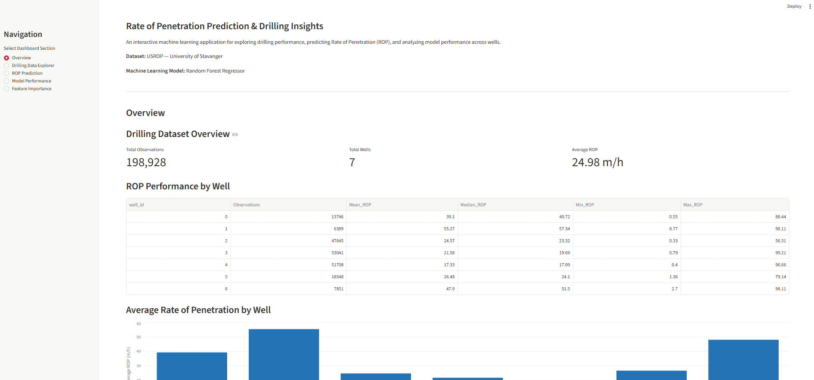
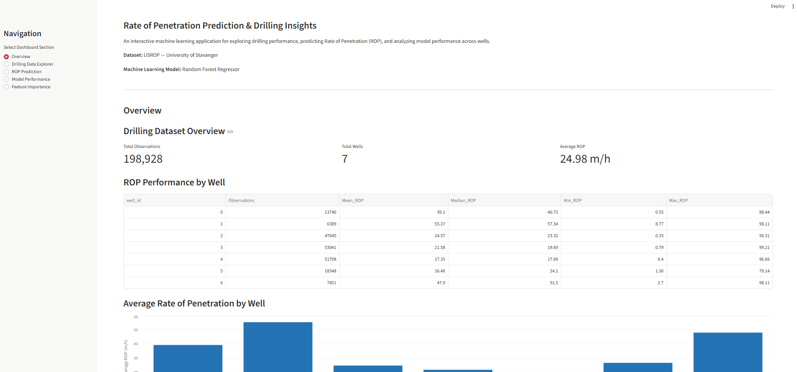

# AI-Powered Drilling Performance Analytics

## Rate of Penetration Prediction & Drilling Insights

An end-to-end machine learning project that analyzes drilling operations data, estimates Rate of Penetration (ROP), and presents drilling performance insights through an interactive Streamlit dashboard.

### Project Overview

This project combines petroleum engineering, geoscience, data analytics, and machine learning to explore drilling performance across multiple wells.

Using the University of Stavanger USROP dataset, the project implements:

- Drilling data preprocessing and quality assessment
- Exploratory data analysis across seven wells
- Random Forest regression for ROP estimation
- Model evaluation using held-out wells
- Feature importance analysis
- Interactive drilling performance visualization
- User-defined drilling parameter inputs for ROP estimation

### Technology Stack

**Programming:** Python

**Machine Learning:** Scikit-learn, Random Forest Regression

**Data Processing:** Pandas, NumPy, PyArrow

**Visualization:** Matplotlib, Seaborn, Streamlit

**Development Tools:** VS Code, Git, GitHub

### Project Scope

The model estimates ROP from drilling measurements. It is an educational and research demonstration, not a validated operational drilling optimization or real-time forecasting system.

## Dataset

This project uses the University of Stavanger Rate of Penetration (USROP) dataset, containing drilling measurements from seven wells.

- Total observations: 198,928
- Number of wells: 7
- Target variable: Rate of Penetration (ROP), measured in m/h
- Data format: CSV, converted to Parquet after preprocessing

### Drilling Parameters

The model uses nine input features:

1. Weight on Bit (kkgf)
2. Average Standpipe Pressure (kPa)
3. Average Surface Torque (kN.m)
4. Average Rotary Speed (rpm)
5. Mud Flow In (L/min)
6. Corrected Mud Density (g/cm³)
7. Hole Diameter (mm)
8. Average Hookload (kkgf)
9. Gamma Ray (gAPI)

### Data Preprocessing

The preprocessing workflow prepares drilling measurements for machine learning, including data-quality checks and feature preparation.

A provisional mud-density unit conversion was applied to Well 3, treating its source values as pounds per gallon (ppg). This assumption has not been independently verified and is a limitation of the analysis.

Raw and processed datasets are excluded from the GitHub repository.

## Machine Learning Methodology

### Model

Random Forest Regressor implemented using Scikit-learn.

### Training and Evaluation

To assess generalization across wells, the dataset was split by well rather than randomly splitting individual drilling observations.

- Training wells: 0, 1, 2, 3, and 4
- Held-out test wells: 5 and 6

This prevents observations from the same well appearing in both training and test sets.

### Evaluation Metrics

| Metric                         | Held-Out Test Result |
| ------------------------------ | -------------------: |
| Mean Absolute Error (MAE)      |            14.34 m/h |
| Root Mean Squared Error (RMSE) |            18.23 m/h |
| R² Score                       |               0.1547 |
| Baseline MAE (Dummy Regressor) |            17.70 m/h |

The Random Forest reduced pooled MAE by approximately 19% compared with the baseline.

However, performance varied across the held-out wells, indicating limited cross-well generalization.

### Model Limitations

- Predictions estimate contemporaneous ROP rather than future drilling performance.
- Generalization to unseen wells remains limited.
- Model predictions are restricted to input ranges represented in training data.
- The Well 3 mud-density correction is based on an unverified unit assumption.
- Feature importance measures model reliance and does not establish causality.
- The model is intended for research, education, and portfolio demonstration only, not operational drilling decisions.

## Installation and Usage

### Prerequisites

- Python 3.12
- Git
- Internet access to install Python dependencies

### 1. Clone the Repository

```bash
git clone https://github.com/YOUR_USERNAME/drilling-performance-ml.git
cd drilling-performance-ml
```

Replace `YOUR_USERNAME` with the actual GitHub username after the repository is published.

### 2. Create a Virtual Environment

```bash
python -m venv .venv
```

Activate the environment in Windows PowerShell:

```powershell
.\.venv\Scripts\Activate.ps1
```

### 3. Install Dependencies

```bash
python -m pip install -r requirements.txt
```

### 4. Launch the Streamlit Dashboard

```bash
streamlit run app.py
```

Streamlit will display a local URL, typically:

http://localhost:8501

Open the URL in your browser to explore the dashboard.

### Dashboard Features

The application includes five interactive sections:

1. **Overview:** Dataset statistics and well-level ROP comparisons.
2. **Drilling Data Explorer:** Drilling measurements, depth profiles, and parameter relationships.
3. **ROP Prediction:** Random Forest ROP estimates using user-defined drilling parameters.
4. **Model Performance:** Evaluation metrics, prediction comparisons, and residual analysis.
5. **Feature Importance:** Relative importance of the model's nine input features.

### ROP Prediction Dashboard

The interactive Streamlit dashboard allows users to enter drilling parameters and generate Random Forest estimates of Rate of Penetration (ROP).



### Model Performance Dashboard

The Model Performance dashboard presents the Random Forest model's evaluation results on held-out wells, including MAE, RMSE, R², comparisons with the baseline model, and prediction error visualizations.



### Data Availability

The original and processed USROP datasets are not included in this repository.

The trained model is included for reproducibility of ROP estimation. Dataset-dependent dashboard sections require the processed dataset to be generated locally.

Data preparation instructions and the original dataset source should be consulted before attempting full reproduction of the analysis.

## Data Preparation and Reproducibility

### Obtain the Dataset

Download the seven USROP benchmark CSV files from the University of Stavanger's published dataset.

Place the files in the following directory:

```text
drilling-performance-ml/
└── data/
    └── raw/
        ├── USROP_A*.csv
        └── ... (seven CSV files in total)
```

The preprocessing script searches for files matching `USROP_A*.csv`.

### Run Data Preprocessing

From the project root, with the Python virtual environment activated and dependencies installed, execute:

```powershell
python src/preprocess.py
```

The script:

1. Loads and combines the seven well datasets.
2. Assigns well IDs based on sorted CSV filenames.
3. Performs drilling data-quality checks.
4. Preserves the original mud-density measurements.
5. Applies a provisional mud-density unit correction to Well 3.
6. Saves the processed dataset in Parquet format.
7. Reloads the saved file to verify data integrity.

### Expected Output

```text
data/processed/usrop_processed.parquet
```

The processed dataset contains 198,928 drilling observations across seven wells.

**Important:** The preprocessing workflow assumes that the seven expected CSV files are present and that their alphabetical ordering matches the original development environment. The Well 3 mud-density conversion is an unverified assumption.

Raw and processed datasets are excluded from Git version control.
